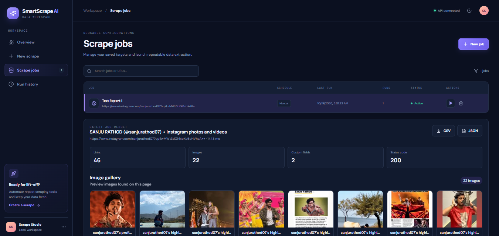

# SmartScrape AI 🚀

**Turn a URL into useful, analysis-ready web data.** SmartScrape AI is a
web scraping workspace that lets you create multiple jobs, run them
manually, or automate recurring extraction---all from a clean dashboard.



## ✨ Features

-   **Simple URL-based scraping:** provide a target URL and run a
    scrape.
-   **Images and video discovery:** preview images in a gallery and view
    available video clips or follow links to the original page to play
    them.
-   **Analysis-ready exports:** download extracted results as **CSV** or
    **JSON** for your own analysis.
-   **Multiple saved jobs:** create, save, run, search, and delete
    reusable scraping jobs.
-   **Flexible automation:** run jobs manually or schedule them for
    **every 15 minutes, hourly, or daily**.
-   **Activity and overview:** review job status, run history, and
    result summaries from the dashboard.
-   **Result preview:** inspect extracted links, images, custom fields,
    and status information before exporting.

## 🧰 Tech Stack

-   **Frontend:** React + Vite
-   **Backend:** Python + Django REST Framework
-   **Data formats:** CSV and JSON

## 🚀 Getting Started

``` bash
git clone https://github.com/hemantkarne70-tech/SmartScrape-AI.git
cd SmartScrape-AI
```

Follow the setup instructions for the frontend and backend in the
repository. Configure the required environment variables, start the API
and frontend, and start the scheduler service to enable automatic jobs.

> **Scheduling note:** Scheduled jobs run only while the backend
> scheduler is running and configured correctly. Scraping results depend
> on each website and the scraper configuration. Respect website terms,
> robots.txt, privacy, and applicable laws; do not bypass access
> controls or collect data you are not authorized to access.

## 🤝 Contributing

Suggestions, issues, and pull requests are welcome. Please open an issue
to discuss significant changes.

## 📄 License

Add a `LICENSE` file to specify the permissions for using, modifying,
and distributing this project.

------------------------------------------------------------------------

## 👨‍💻 Author

**Hemant Karne**

Software Engineer | Python | Beautiful Soap | Scrape AI | Automation | Scheduler | JavaScript

GitHub: [@hemantkarne70-tech](https://github.com/hemantkarne70-tech)


⭐ If SmartScrape AI is useful to you, star the repository and share
your feedback!
